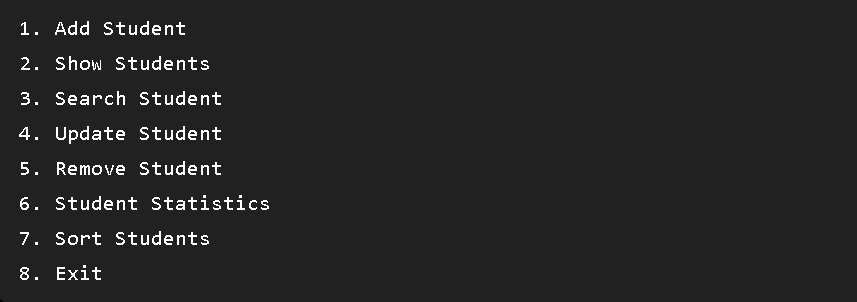
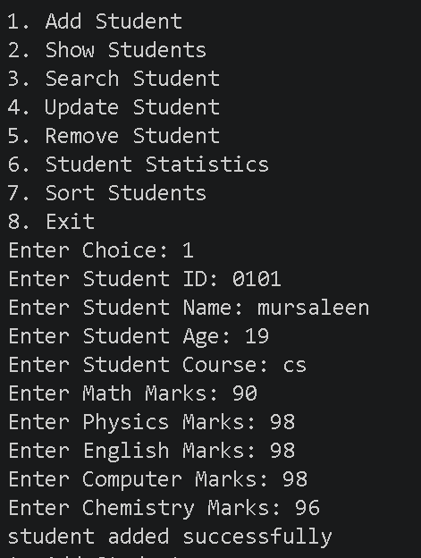
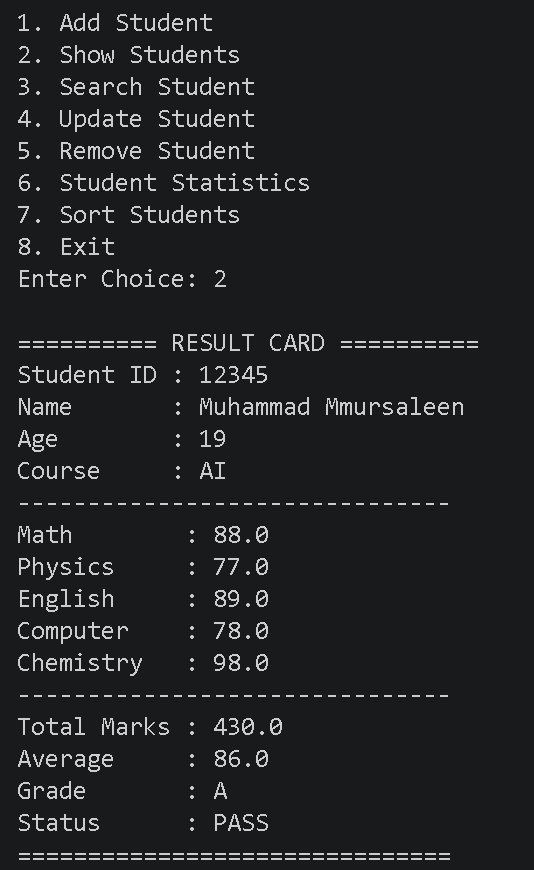
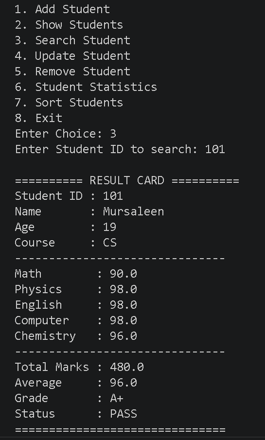
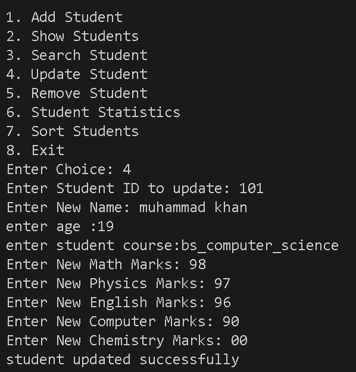
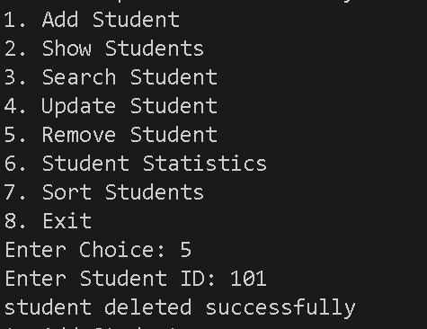
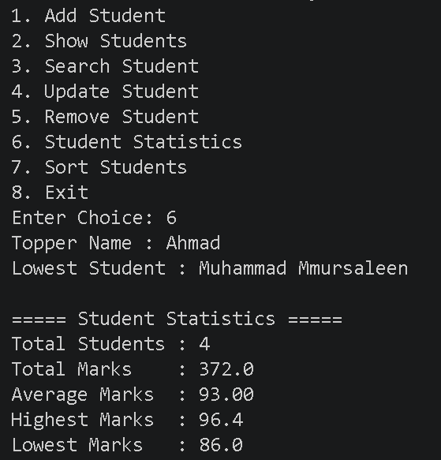
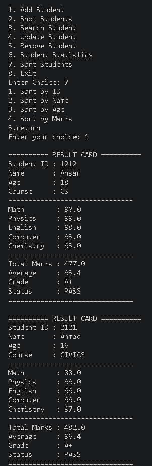
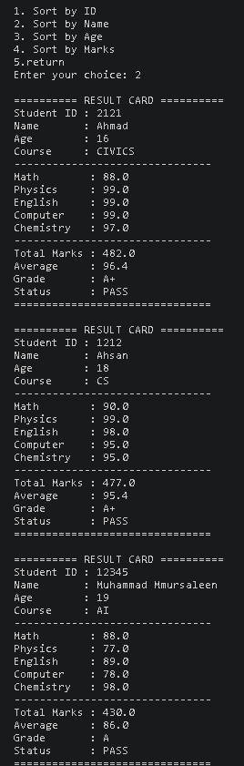
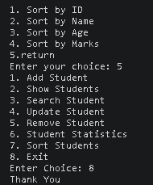

# 🎓 Student Management System

A complete **Student Management System** developed in **Python** using **Object-Oriented Programming (OOP)**, **JSON**, and **File Handling**.

This project allows users to manage student records through a command-line interface with permanent JSON storage.

---

## ✨ Features

- ➕ Add Student
- 📋 Show Students
- 🔍 Search Student
- ✏️ Update Student
- ❌ Remove Student
- 📊 Student Statistics
- 🔃 Sort Students
- 📝 Automatic Result Card
- 🎯 Grade Calculation
- 💾 Permanent JSON Database

---

## 🛠 Technologies Used

- Python 3
- OOP
- JSON
- File Handling
- Exception Handling

---

## 📁 Project Structure

```text
Student-Management-System/
│
├── main.py
├── student.py
├── module.py
├── database.py
├── database.json
├── README.md
└── screenshots/
```

---

## 🚀 How to Run

```bash
python main.py
```

---

## 📸 Screenshots

## Main Menu


## Add Student


## Result Card


## Search Student


## Update Student


## Delete Student


## Student Statistics


## Sort by ID


## Sort by Name


## Exit

## 📚 Concepts Used

- Classes & Objects
- Dictionaries
- Lists
- Functions
- CRUD Operations
- JSON Database
- File Handling
- Searching
- Sorting
- Exception Handling

---

## 🔮 Future Improvements

- Login System
- Attendance Management
- Teacher Panel
- SQLite Database
- GUI Version (Tkinter)

---

## 👨‍💻 Author

**Muhammad Mursaleen**

Python Developer

⭐ If you like this project, don't forget to star the repository.
